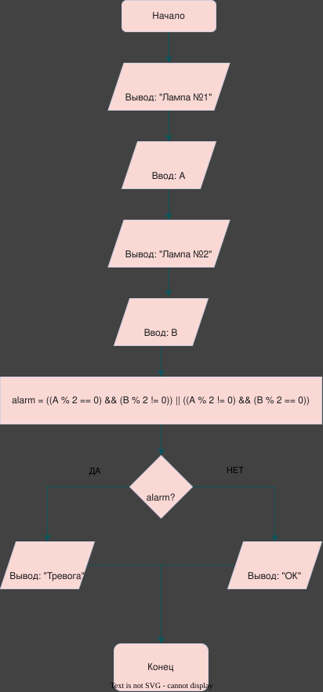
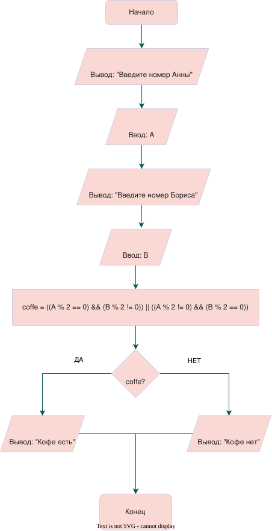

# Лабораторная работа №4

---

## 1. Вариант

**Вариант 5 (Вариант 1)**

---

## 2. Условие задач

### a. Ночное дежурство

Два программиста, Анна ($A$) и Борис ($B$), дежурят ночью. Чтобы было не так скучно, они решили, что будут пить кофе только если кто-то один из них четный (по номеру своего рабочего места). Запишите условие для кофе-машины.

### b. Четный индикатор

Прибор на заводе имеет две контрольные лампы, соответствующие значениям датчиков $A$ и $B$. Сирена тревоги должна загораться, если ровно одна из ламп показывает нечетное значение. Запишите условие для включения сирены.

---

## 3. Блок-схема

* **Блок-схема для задачи 1:**  
  

* **Блок-схема для задачи 2:**  
  

---

## 4. Реализация программы

```c
#include <locale.h>
#include <stdio.h>

int def_1_V1();
int def_2_V5();

int main(){
    setlocale(LC_ALL, ".UTF8");

    def_1_V1();
    def_2_V5();

    return 0;
}

int def_1_V1(){
    int A, B;

    puts("Введите номер Анны");
    scanf("%d", &A);

    puts("Введите номер Бориса");
    scanf("%d", &B);

    int coffe = ((A % 2 == 0) && (B % 2 != 0)) || ((A % 2 != 0) && (B % 2 == 0));
    
    printf("%s\n", coffe ? "Кофе есть" : "Кофе нет");

    return 0;
}

int def_2_V5(){
    int A, B;

    puts("Лампа №1");
    scanf("%d", &A);

    puts("Лампа №2");
    scanf("%d", &B);

    int alarm = ((A % 2 == 0) && (B % 2 != 0)) || ((A % 2 != 0) && (B % 2 == 0));

    printf("%s\n", alarm ? "Тревога" : "ОК");

    return 0;
}
```

---

## 5. Результат работы программы

### a. Для первой программы (Ночное дежурство)

**Случай 1 (Условие выполняется — Ровно один четный номер):**
```text
Введите номер Анны
2
Введите номер Бориса
5
Кофе есть
```

**Случай 2 (Условие не выполняется — Оба номера четные/нечетные):**
```text
Введите номер Анны
4
Введите номер Бориса
6
Кофе нет
```

---

### b. Для второй программы (Четный индикатор)

**Случай 1 (Условие выполняется — Ровно одна лампа нечетная):**
```text
Лампа №1
3
Лампа №2
8
Тревога
```

**Случай 2 (Условие не выполняется — Обе лампы четные/нечетные):**
```text
Лампа №1
2
Лампа №2
4
ОК
```

---

## 6. Информация о разработчике

*(Добавить информацию о себе)*
